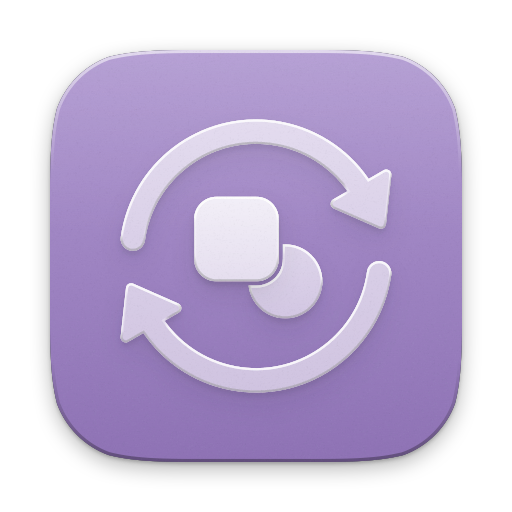

# Morphit

Morphit converts audio, video and images. It is a single window: drop files or folders, and each kind of file goes into its own group (Video, Audio, Images), with its own template.

## How it works

1. **Files.** Drop files or folders on the window or the Dock icon, use **+** (⌘O), or *Open With › Morphit* in Finder. Folders are searched for media. Each row shows size, codec and duration, then the progress, the result (the small folder shows it in Finder) or the reason for a failure. ✕ removes a file from the list.
2. **Groups.** Each group has its template menu, with only the templates its files can become (video files can also take an audio template: the sound is extracted). On the right: the count, ⚙︎ the group's settings (the everyday ones, then **Advanced settings**; **Save** puts changes into the template or into a new one), ⊗ removes its files, ▶ converts just this group.
3. **Toolbar.** **+** add, **Clear Finished** (the eraser) removes the files already through a conversion (converted, failed or stopped), ▶ **Convert All** (⌘↩): every group with its own template; ■ Stop (⌘.). The icon next to the title turns while converting. The status bar at the bottom sums up the list; after a conversion an **Undo** button rises into it, which deletes the new files and puts the originals back from the Trash. Where files go, and the CPU level, are in Settings.

An existing file is never replaced: the new one gets " 2", " 3"…. Files are written under a hidden temporary name and renamed when complete, so a stopped conversion leaves nothing behind.

### "Same as source"

Every parameter starts there, and it means the source's real value, read with ffprobe, passed to the encoder explicitly:

| Parameter | Same as source means | Adapted when |
| --- | --- | --- |
| Audio bitrate | the source stream's bitrate (measured from the packets when the container doesn't say, e.g. WebM) | lossless source: 320 kbps; MP3: next standard step; capped at the format's maximum |
| Sample rate | the source's | MP3 / AAC hold up to 48 kHz (96 → 48, 88.2 → 44.1); Opus is always 48 kHz |
| Channels | the source's | MP3 holds two: 5.1 is mixed down to stereo |
| Bit depth (WAV, FLAC, ALAC) | the source's (16, 24, 32 float) | lossy sources: 16-bit; FLAC: at most 24 |
| Video codec | kept, and the stream is copied without re-encoding | the container can't hold it (VP9 into MP4 → H.264), or something forces a re-encode |
| Video quality | the source's bitrate, scaled to the new picture size | — |
| Resolution, frame rate | unchanged | — |
| Audio track (video) | copied | the container can't hold it: AAC (Opus for WebM) at the source bitrate |
| Image quality | a JPEG's own quality, estimated from its tables | other lossy sources 90, lossless 95 |
| Image metadata, colour profile | kept | WebP and AVIF: written by ffmpeg without metadata, in sRGB |

When something is adapted, the file's row says so ("Mixed down to stereo: MP3 holds two channels.").

### Parameters

| Kind | Main | Advanced |
| --- | --- | --- |
| Audio | bitrate, sample rate, channels (same as source / mono / stereo) | M4A codec (AAC / Apple Lossless), CBR / VBR, bit depth, FLAC level, loudness normalisation (EBU R128, −16 LUFS), tags, cover art |
| Video | codec, quality (same as source / high / medium / small), resolution (short side, never enlarged), frame rate, audio track (same as source / convert / remove) | encoder (automatic / hardware / software), speed, custom CRF, all audio tracks, subtitles, metadata and chapters, GIF loop |
| Image | quality, resize (long side px, short side px, megapixels, percentage), metadata (same as source / remove location / remove all) | allow enlarging, convert to sRGB, TIFF compression, WebP lossless |

Video encoders: H.264 and HEVC use the Mac's hardware encoder (VideoToolbox) by default, or x264 / x265 in software; AV1 SVT-AV1; VP9 libvpx; ProRes Apple's encoder. 10-bit HEVC and AV1 stay 10-bit. HEVC files get the `hvc1` tag so QuickTime and iOS play them. Images keep transparency in PNG, HEIC, HEIF, WebP and TIFF; JPEG, BMP and AVIF get a white background. The EXIF orientation is applied to the pixels.

## Settings (⌘,)

- **General.** Where converted files go. CPU usage: *Low* (one file at a time on two cores, low priority), *Balanced* (half the performance cores' worth of files, half the cores), *Maximum* (one file per performance core, all cores). *Move originals to the Trash after converting*, off by default: only after the converted file is complete and renamed, never on failure or Stop, never deleted outright. *Settings and templates*: **Export…** saves these settings and every template in one JSON file; **Import…** reads one back (the general settings are replaced; the templates replace yours or are added to them).
- **Templates.** Create (+, by format), duplicate, delete (− deletes any template, built-in ones too; ⌘Z puts it back); name, format and parameters, with the technical ones under **Advanced settings**. Saved in `~/Library/Application Support/Morphit/templates.json`. *Add Missing Built-in Templates* brings back the starting set (MP3, M4A 256 kbps stereo, WAV, FLAC, Opus, MP4, MKV, MOV, WebM, GIF, JPEG, PNG, HEIC, WebP, AVIF, TIFF).

## Tools inside the app

`Contents/Resources/bin` holds, unchanged:

| Tool | Source | Use | License |
| --- | --- | --- | --- |
| ffmpeg 9.0.2 (static, arm64) | ffmpeg.martin-riedl.de | audio, video, WebP, AVIF, GIF | GPL |
| ffprobe 9.0.2 (static, arm64) | ffmpeg.martin-riedl.de | reading streams, bitrates, durations | GPL |

Images are read and written by macOS itself (ImageIO and Core Image): every image it can open (RAW, HEIC, AVIF, WebP…) goes in; JPEG, PNG, HEIC, HEIF, TIFF and BMP come out with their metadata, resized with Lanczos. WebP and AVIF are written by ffmpeg.

The ffmpeg build includes x264, x265, SVT-AV1, libaom, libvpx, LAME, Opus, Vorbis, libwebp and Apple's AudioToolbox AAC and VideoToolbox encoders. The binaries are distributed unchanged under the GPL; the source is at https://ffmpeg.org/releases/ffmpeg-9.0.2.tar.xz and the build scripts at https://git.martin-riedl.de/ffmpeg/build-script.

## Permissions

Morphit asks for nothing at launch.

- **Folders**: macOS protects Desktop, Documents and Downloads. The first time Morphit writes a converted file there (or moves an original to the Trash), macOS asks once.
- **Notifications** (optional): asked the first time a conversion starts; a banner when it ends while you're in another app.

## Building

```
scripts/setup-signing.sh   # once: local signing identity in signing/
scripts/build-app.sh       # downloads the engine if needed, builds, signs, installs in /Applications
scripts/make-dmg.sh        # installer: build/Morphit-<version>.dmg
```

`scripts/fetch-tools.sh` downloads ffmpeg and ffprobe into `vendor/bin` and checks their published checksums. The app is about 130 MB, almost all of it the engine. Apple Silicon only (the bundled ffmpeg is arm64). `scripts/make-icon.swift` draws the icon.

Command-line test modes, without the window:

```
MORPHIT_TOOLS=vendor/bin .build/debug/Morphit --probe FILE
MORPHIT_TOOLS=vendor/bin .build/debug/Morphit --settings-roundtrip FILE                       # export, read back, compare
MORPHIT_TOOLS=vendor/bin .build/debug/Morphit --plan '{"format":"mp3"}' FILE                 # ffmpeg arguments only
MORPHIT_TOOLS=vendor/bin .build/debug/Morphit --convert '{"format":"m4a","audio":{"bitrate":256,"channels":"stereo"}}' \
    [--out DIR] [--cpu low|balanced|maximum] [--trash] [--stop-after SECONDS] FILE...
```

The template JSON uses the keys of `templates.json`; anything left out is "Same as source".

Layout checks without Screen Recording: `open --env MORPHIT_SNAPSHOT=<dir> /Applications/Morphit.app` writes a PNG of each window every second: `<name>.png` as the views draw it, `<name>-screen.png` as the window server composites it (materials and vibrancy included; an app may capture its own windows). Optional:

- `MORPHIT_SNAPSHOT_ADVANCED=video|audio|image`: opens that group's settings
- `MORPHIT_SNAPSHOT_OPEN=templates|general`: opens Settings
- `MORPHIT_SNAPSHOT_CONVERT=1`: converts everything 4 s after launch
- `MORPHIT_SNAPSHOT_CYCLE=1`: switches the Settings tab every 2 s
- `MORPHIT_FRAMELOG=1`: window sizes, visibility and transparency every 10 ms (`frames.log`), the window with the focus every 20 ms (`key.log`); `burst` also saves each window's real pixels for 1.5 s whenever it comes on screen (`burst/`)
